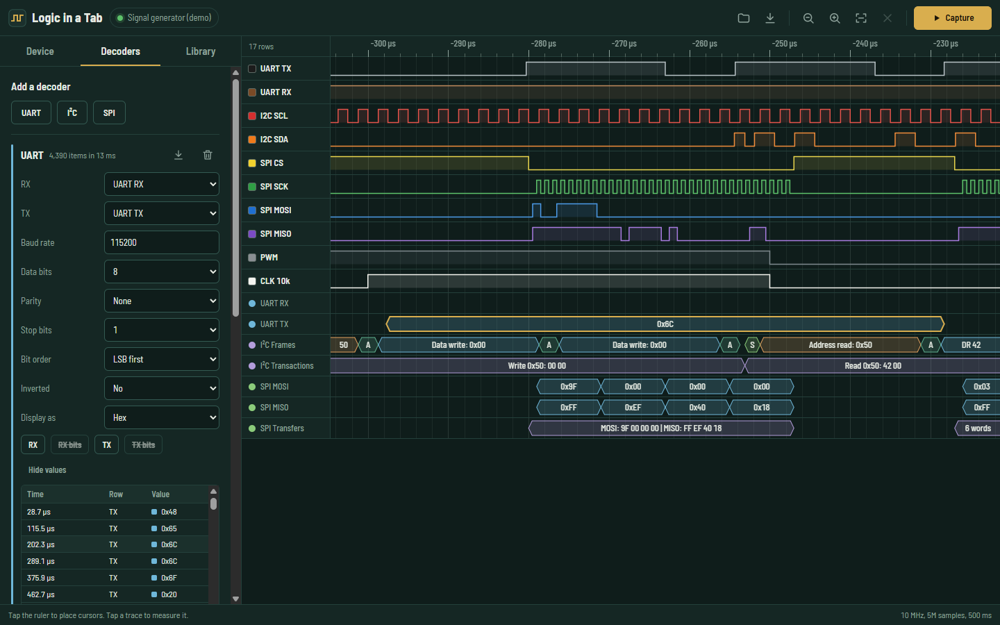
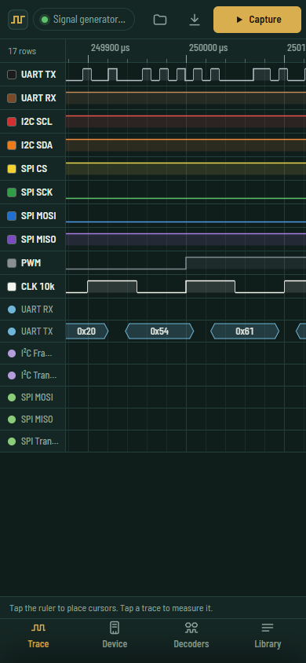

# Logic in a Tab

A logic analyzer that runs in your browser. Plug a Raspberry Pi Pico running
logic-analyzer firmware into a computer or an Android phone, capture up to 24
channels, decode UART, I²C and SPI, and swap files with PulseView. Nothing to
install: it is a PWA that keeps working offline.



## What it does

- **Captures from two Pico-based analyzers over USB**, straight from the page:
  - [gusmanb/logicanalyzer](https://github.com/gusmanb/logicanalyzer), firmware V6 or newer. You get up to 24 channels at 100 MHz (200 MHz on turbo builds), plus edge, pattern, fast-pattern and blast triggers, and burst captures with measured gaps.
  - [sigrok-pico](https://github.com/pico-coder/sigrok-pico). You get 21 digital channels (26 or 32 on the "dig" builds) plus 3 analog, streamed over USB.
- **Handles millions of samples.** Drawing cost depends on screen width, not capture length, so a 50-million-sample capture pans and zooms as smoothly as a short one.
- **Decodes UART, I²C and SPI** with TypeScript decoders:
  - UART supports 5 to 9 data bits, parity, 1, 1.5 or 2 stop bits, MSB-first and inverted lines, and break detection.
  - I²C supports 7- and 10-bit addresses, repeated starts, and ACK/NACK.
  - SPI supports all four modes, any word size, with or without chip select.
  - Results show as annotation rows on the trace and in a table, and export to CSV.
- **Reads and writes sigrok `.sr` files** that open in PulseView 0.4.x and sigrok-cli. Analog channels included.
- **Keeps a capture library** in browser storage (IndexedDB). It also remembers the decoder setup used with each capture.
- **Measures.** Cursors A and B show time and frequency. Tapping or hovering a trace shows that pulse's width, period, frequency and duty cycle.
- **Works on phones.** Pinch to zoom, drag to pan, and settings sit in a bottom sheet.



## Try it without hardware

Pick one of three options under **Device**:

| Option | What it exercises |
| --- | --- |
| Signal generator | Builds up to 50M samples of realistic traffic directly: UART text, an I²C EEPROM, a SPI flash ID read, PWM and a clock. |
| Simulated gusmanb analyzer | Runs the real gusmanb driver against a model of the V6 firmware over an in-memory serial port: framing, handshake, capture request, binary transfer. |
| Simulated sigrok-pico | Runs the real sigrok-pico driver against a model of its firmware, including the run-length stream encoding and analog channels. |

The empty screen's **Try a demo capture** button generates a capture and adds all three decoders.

## Browser support

| Where | How it connects |
| --- | --- |
| Chrome, Edge, Opera on Windows, macOS, Linux, ChromeOS | **USB serial** (Web Serial API) |
| Firefox 151+ on desktop | USB serial (may ask for a site permission add-on) |
| Chrome 148+ on Android 17+ | USB serial |
| Chrome on older Android versions | **WebUSB** mode: talks to the Pico's CDC-ACM interface through [web-serial-polyfill](https://github.com/google/web-serial-polyfill) |
| Safari, iOS | No USB access; the demo, simulators and `.sr` files still work |

Chrome on Android reports `navigator.serial` from version 138 onwards, but wired USB serial only works from Chrome 148 on Android 17. Feature detection can't tell the two apart, so the app offers both connection methods and defaults to WebUSB on phones. The page has to be served over HTTPS (or `localhost`) for any USB access.

## Hardware setup

1. Flash the firmware onto a Pico by holding BOOTSEL, plugging it in and copying the UF2 file.
   - gusmanb: a `LogicAnalyzer_*.uf2` from the [releases](https://github.com/gusmanb/logicanalyzer/releases). Pick the one for your board (Pico, Pico 2, W or Zero).
   - sigrok-pico: the UF2 from the [sigrok-pico releases](https://github.com/pico-coder/sigrok-pico/releases).
2. Connect probe wires and a common ground.
   - gusmanb channels 1–21 are GPIO 2–22, and channels 22–24 are GPIO 26–28.
   - sigrok-pico's default build starts at GPIO 2.
3. In the app, open **Device**, choose the analyzer, press **Choose port and connect**, then **Capture**.

Close other programs that hold the port first (PulseView, the gusmanb desktop app, serial monitors).

## Development

```sh
npm install
npm run dev        # Vite dev server
npm test           # 215 unit and integration tests (vitest)
npm run coverage   # coverage report
npm run build      # type-check + production build with service worker
```

Requires Node 22+. The stack is Preact, TypeScript and Vite, with fflate for ZIP and vite-plugin-pwa for offline support.

## How it works

```
src/
  core/        capture model, multi-resolution sample index, measurements, signal synthesizer
  decoders/    UART, I2C, SPI (pure functions over the sample index)
  drivers/
    serial/    byte-stream link over Web Serial / WebUSB, port picking
    gusmanb/   framed binary protocol, 48-byte capture request, limits
    sigrokPico/ text commands and the streamed sample decoder
    sim/       firmware models for both devices (tests and in-app simulators)
    demo/      demo scenario and generator device
  formats/     sigrok .sr reader/writer
  storage/     IndexedDB capture library
  render/      viewport math and canvas drawing
  app/         Preact UI
```

**Samples** are stored packed: one 8-, 16- or 32-bit word per sample, where bit *n* is channel *n*. This is also sigrok's on-disk layout, so `.sr` import and export are plain copies.

**The sample index** (`core/pyramid.ts`) stores the bitwise OR and AND of every block of 32 samples, then of every 4 blocks, and so on up. For any range of samples, one lookup tells whether each channel stayed low (OR bit clear), stayed high (AND bit set) or changed.
- The renderer does this once per pixel column for all channels together.
- Decoders use the same blocks to jump over idle stretches when searching for the next edge. A UART decode of 10 million samples takes tens of milliseconds.
- The index costs about 1/16 of the sample memory.

**Rendering** uses Canvas 2D. Because each frame's work is proportional to the canvas width, WebGPU would not change how fast it scales, so it is left out.

**Drivers** run against any `PortLike`: a real `SerialPort`, the WebUSB polyfill's port, or an in-memory fake. That is how the tests and the in-app simulators drive the exact code that talks to hardware.

## Compatibility notes

- `.sr` files are written the way libsigrok 0.5.2 writes them:
  - a one-byte `version` of `2`;
  - GKeyFile-style `metadata`, with rates written as `1 MHz`, `12.5 MHz`;
  - 4 MiB `logic-1-N` chunks, and `analog-1-N-M` float32 chunks numbered after the logic probes.
- On import, older files using `key = value` spacing, CRLF line endings, or a single unchunked `logic-1` are accepted too.
- Trigger position and burst markers are not part of the `.sr` format, so they do not survive a round trip through PulseView. Channel names and analog data do.

## Status and limitations

- **Tested against firmware models, not yet on physical hardware.** The protocol details come from reading the current firmware and host-driver source of both projects. The included simulators reproduce that behaviour, and the drivers pass against them. Reports from real boards are welcome.
- Decoders run on the main thread. They are fast enough for tens of millions of samples, but they would move to a worker for anything heavier.
- Not included yet (stretch goals from the original plan):
  - uploading firmware to fx2lafw dongles over WebUSB;
  - running sigrok's Python decoders through Pyodide (which would make the project GPL).

## Licensing

MIT. See [LICENSE](LICENSE).

- **Written from protocol descriptions.** The device protocols and the `.sr` format were implemented from descriptions of how they work. No code from the GPL-3.0 projects (gusmanb/logicanalyzer, sigrok-pico, libsigrok, libsigrokdecode) was copied or translated.
- **Bundled dependencies:**
  - Preact (MIT)
  - fflate (MIT)
  - web-serial-polyfill (Apache-2.0)
  - Barlow Semi Condensed (SIL OFL 1.1)
