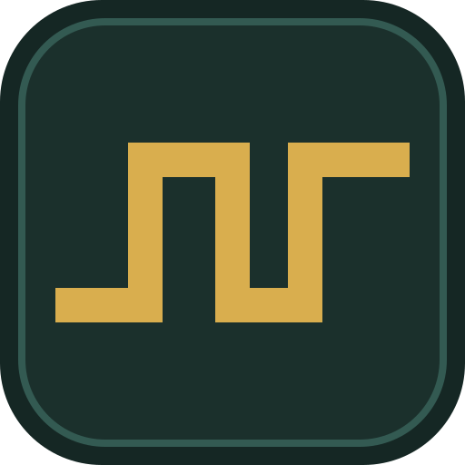
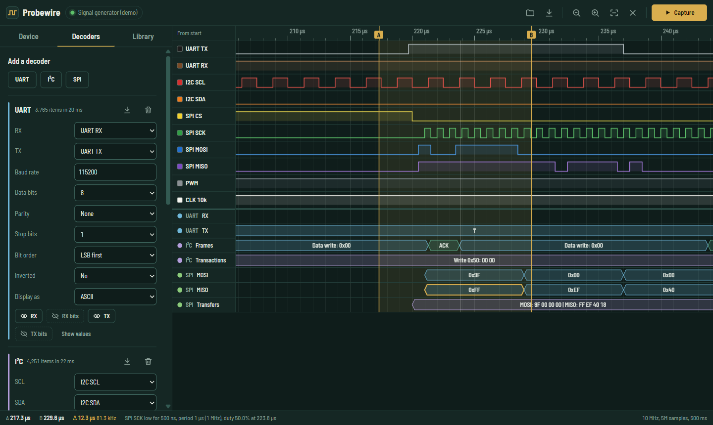
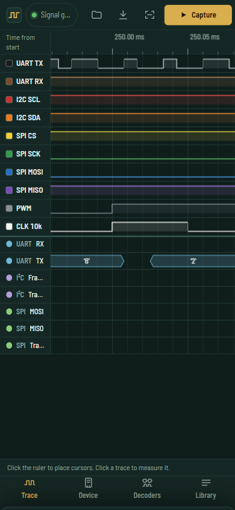

<div align="center">



# Probewire

**A logic analyzer in your browser tab.**

Capture from a Raspberry Pi Pico over USB, decode UART, I²C and SPI, and open the result in PulseView.
Nothing to install: it is a web app that keeps working offline.

[](https://github.com/byjoellobo/probewire/actions/workflows/ci.yml)
[](https://github.com/byjoellobo/probewire/actions/workflows/deploy.yml)
[](https://github.com/byjoellobo/probewire/actions/workflows/codeql.yml)
[](https://github.com/byjoellobo/probewire/releases)
[](LICENSE)

[**Open Probewire**](https://byjoellobo.github.io/probewire/) · [Getting started](docs/getting-started.md) · [Hardware](docs/hardware.md) · [Docs](docs/README.md)

</div>



## Why

A logic analyzer shows the digital signals between chips, so you can watch a
microcontroller talk over UART, I²C or SPI. The cheapest capable hardware is now
a $4 Raspberry Pi Pico, but the software still assumes a desktop install.
Probewire is the analyzer front end as a web page: it talks to the Pico straight
from the browser, on a laptop or on an Android phone.

## Features

- **Two Pico analyzers, straight over USB**
  - [gusmanb/logicanalyzer](https://github.com/gusmanb/logicanalyzer) firmware V6+: up to 24 channels at 100 MHz (200 MHz on turbo builds); edge, pattern and blast triggers; burst captures.
  - [sigrok-pico](https://github.com/pico-coder/sigrok-pico): up to 32 digital and 3 analog channels, streamed over USB.
- **Millions of samples, smooth.** Drawing cost depends on screen width, not capture length, so a 50-million-sample capture pans and zooms like a short one.
- **Protocol decoders** for UART, I²C and SPI, shown as annotation rows, in a searchable table, and exportable to CSV.
- **PulseView compatible.** Reads and writes sigrok `.sr` session files, analog channels included.
- **Measurements.** Two cursors give time and frequency, and tapping a trace gives the pulse width, period, frequency and duty cycle.
- **Capture library** kept in the browser, available offline, with the decoder setup saved alongside each capture.
- **Works on phones.** Pinch to zoom, drag to pan, settings in a bottom sheet. Install it as an app on desktop or Android.
- **Try it without hardware.** A signal generator and simulated versions of both analyzers run the real drivers against firmware models.

<p align="center">
  
</p>

## Quick start

1. Open **https://byjoellobo.github.io/probewire/** in Chrome or Edge.
2. Press **Try a demo capture** to explore without hardware.
3. To capture for real, flash a Pico with the gusmanb or sigrok-pico firmware ([hardware guide](docs/hardware.md)), plug it in, open **Device**, choose your analyzer and press **Choose port and connect**, then **Capture**.

## Browser support

| Browser                                               | USB access                                         |
| ----------------------------------------------------- | -------------------------------------------------- |
| Chrome, Edge, Opera (Windows, macOS, Linux, ChromeOS) | Web Serial                                         |
| Firefox 151+ (desktop)                                | Web Serial                                         |
| Chrome 148+ on Android 17+                            | Web Serial                                         |
| Chrome on older Android                               | WebUSB mode (built in)                             |
| Safari, any iOS browser                               | Not available; the demo and `.sr` files still work |

Details, caveats and what has been tested: [browser support](docs/browser-support.md).

## Status

Version 0.1.0 is the first public release. Both device drivers are tested
against detailed models of their firmware, but **not yet on physical boards**.
If you have a Pico, a [hardware report](https://github.com/byjoellobo/probewire/issues/new?template=hardware_report.yml)
is the most useful contribution right now.

## Documentation

| Guide                                      | What it covers                                          |
| ------------------------------------------ | ------------------------------------------------------- |
| [Getting started](docs/getting-started.md) | Using the app: capture, navigate, measure, decode, save |
| [Hardware](docs/hardware.md)               | Flashing, wiring, pin maps, limits, troubleshooting     |
| [Browser support](docs/browser-support.md) | Web Serial, WebUSB, HTTPS and permissions               |
| [Decoders](docs/decoders.md)               | UART, I²C and SPI options and output                    |
| [File format](docs/file-format.md)         | `.sr` compatibility with PulseView                      |
| [Architecture](docs/architecture.md)       | How Probewire is built                                  |
| [Device protocols](docs/protocols.md)      | The wire protocols as implemented                       |
| [Development](docs/development.md)         | Building, testing and releasing                         |

## Development

```sh
git clone https://github.com/byjoellobo/probewire.git
cd probewire
npm install
npm run dev        # http://localhost:5173
npm run check      # type-check, lint, formatting, unit tests
npm run test:e2e   # Playwright end-to-end and accessibility tests
```

Requires Node 22 or newer. Built with Preact, TypeScript and Vite. See
[development](docs/development.md) for the project layout and the release process.

## Contributing

Bug reports, hardware reports and pull requests are welcome. Please read the
[contributing guide](CONTRIBUTING.md) and the [code of conduct](CODE_OF_CONDUCT.md).
To report a security issue, follow the [security policy](SECURITY.md).

## License

[MIT](LICENSE) © 2026 Joel Lobo.

Probewire bundles a few open-source components, listed in
[third-party notices](THIRD_PARTY_NOTICES.md). It works with the GPL-licensed
gusmanb and sigrok-pico firmware and the sigrok `.sr` format, but contains none
of their code: the protocols were implemented from descriptions of how they work.
